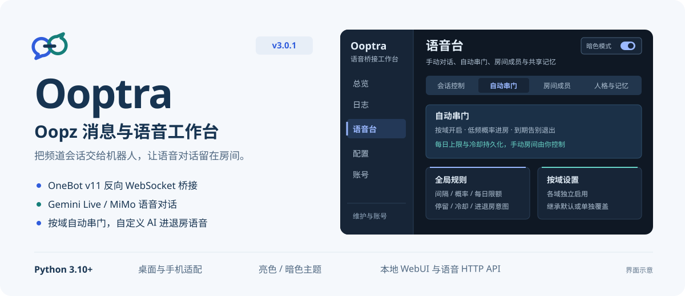

<p align="center">
  
</p>

<p align="center">
  
</p>

<p align="center">
  
</p>

<p align="center">
  <a href="CHANGELOG.md"></a>
  <a href="https://github.com/Eason4869/Ooptra/stargazers"></a>
  <a href="https://github.com/Eason4869/Ooptra/actions/workflows/ci.yml?query=branch%3Amain"></a>
  
  <a href="LICENSE"></a>
</p>

# Ooptra

把 Oopz 文字接入 AstrBot 等 OneBot v11 框架，并让机器人进入 Oopz 语音房自然聊天。

当前开发版：**261019.1-dev**。

> 此版本的人格与双向记忆同步功能需配合 **[astrbot_plugin_ooptra 1.3.0-dev 及以上版本](https://github.com/Eason4869/astrbot_plugin_ooptra/tree/dev)** 使用。单独运行 Ooptra 时，仍可使用本地人格和语音记录。

## 可以做什么

| 功能 | 使用方式 |
| --- | --- |
| 文字桥接 | Oopz 群聊、私聊通过 OneBot v11 反向 WebSocket 连接 AstrBot |
| 实时语音 | Gemini Live 音频输入与输出；MiMo 提供 ASR → LLM → TTS 级联 |
| AstrBot 人格 | 跟随绑定 QQ 群的人格，也可在配套插件中手动选择内置人格 |
| 双向记忆 | 语音检索绑定 QQ 群的记忆；语音对话回传同一个记忆插件采集 |
| 房间管理 | 手动进退房、自动串门、成员状态、抢话、关键词接话、音量与临时闭麦 |
| Web 控制台 | 登录、配置、语音试听、状态与日志、更新、备份和恢复 |

文字回复仍由 AstrBot 处理。Live 的音频对话在 Ooptra 中运行，记忆查询独立于音频收发。

## 安装与启动

需要 Git、Python 3.10+。体验本页开发版：

```powershell
git clone -b dev https://github.com/Eason4869/Ooptra.git
cd Ooptra
python -m venv .venv
.\.venv\Scripts\Activate.ps1
python -m pip install -r requirements.txt
Copy-Item config.example.py config.py
```

Linux / macOS 使用 `source .venv/bin/activate` 和 `cp config.example.py config.py`。正式版选择 `main`，测试版选择 `beta`；本页新增的 AstrBot 上下文同步需使用上面注明的配套版本。

在 `config.py` 填写 Oopz 账号，或启动后在控制台登录。需要语音或浏览器登录时，再安装：

```text
python -m pip install -r requirements-optional.txt
python -m playwright install chromium
python launcher.py
```

打开 `http://127.0.0.1:3090`，首次在部署机器本机设置控制台密码。该密码也是配套插件使用的 API Token。

升级时请保留已有 `config.py`、`private_key.py` 和 `data/`，不要重新复制示例覆盖配置。特别是 `data/onebot_v11.sqlite3`，其中的身份映射需要延续使用。

## 接入 AstrBot

1. 在 AstrBot 新建 OneBot v11 反向 WebSocket 平台。
2. 在 Ooptra「配置 → 连接」填写该平台的反向 WS 地址和相同的访问令牌。
3. 点击保存并重新连接，确认概览中显示已接入。

反向 WS 地址默认示例为 `ws://127.0.0.1:6200/ws`，以 AstrBot 实际配置为准。跨机器部署时，填写部署机器之间能访问的地址。

## 开始语音对话

1. 在「配置 → 语音模型」开启语音，选择 Gemini Live 或 MiMo 级联。
2. 填写对应密钥、模型和音色。
3. 在「语音台 → 会话控制」选择域和频道，然后进房。
4. 使用「自检与试听」先检查环境、音色及进退房台词。

默认语音回复概率为 30%。强制关键词、连续追问窗口、监听成员范围和抢话门限均可配置。手动开口、语音退房、音量和临时闭麦规则见[语音指南](docs/voice-guide.md)。OpenAI Realtime 尚未接入。

## 与 QQ 群共享人格和记忆

在 AstrBot 安装配套插件，然后在它的工作台完成：

1. 将插件 `api_base` 指向 Ooptra，例如 `http://127.0.0.1:3090`，`api_token` 填控制台密码。
2. 使用已有群绑定，将 QQ 群绑定到 Oopz 域／语音频道。
3. 开启「人格与双向记忆」，选择人格和主记忆插件。
4. 重新进房，或点击「刷新当前语音上下文」。刷新会重建当前模型会话。

例如，在 QQ 群记录一次活动约定后，可以在绑定语音房询问这项约定；语音中的新对话会交给同一个记忆插件，供之后 QQ 聊天使用。普通聊天的长期总结由记忆插件决定时机；明确要求“记住”时，只有收到成功结果才可确认写入。

当前适配 **Memory Companion** 和 **LivingMemory**。自动检测针对已实现适配器的插件及其实际接口；同时启用多个记忆插件时，需要选择一个主插件。权限校验、白名单或群采集设置阻止访问时，工作台会显示原因。

### 来源如何确定

- QQ 指令、控制台进房、自动串门都按当前实际语音房反查现有群绑定。
- 一个房间须有唯一 QQ 群来源；无绑定或多个匹配时，使用本地设置并显示原因。
- 同步当前支持 QQ 的 `aiocqhttp` 平台。多个 QQ 实例时，在插件指定平台 ID。
- 语音可手选不同人格；共享记忆始终跟随绑定 QQ 群的记忆范围与人格过滤。
- Oopz UID 与 QQ 号需显式关联，才能准确标注个人身份；未关联者使用 Oopz 来源身份，不根据昵称猜测。
- 成员独立 QQ 会话不能自动归并为唯一群会话；公共语音不自动读取私聊记忆。

在 Ooptra「语音台 → 人格与记忆」可查看来源群、人格、记忆插件和待写条数。本地 JSONL 记录与 AstrBot 长期记忆分别管理，清空本地记录不会删除 QQ 群记忆。

## 自动串门与日常维护

在「语音台 → 自动串门」逐域启用。检查间隔、进房概率、停留时间、进退房台词、冷却和每日上限可以调整；默认全部关闭。当前实例同一时间只维护一个语音房会话。

控制台「更新与备份」提供 `main`、`beta`、`dev` 频道检查、备份及恢复。自动部署请通过 `python launcher.py` 启动。局域网访问需设置访问密码，并将监听地址改为 `0.0.0.0`。

| 需要帮助 | 文档 |
| --- | --- |
| 语音、播放、试听和 API | [语音指南](docs/voice-guide.md) |
| 自动串门 | [串门说明](docs/voice-guide.md) |
| 配置、数据文件、启动和升级 | [配置与维护](docs/operations.md) |
| 同步协议、适配边界与验证 | [AstrBot 同步说明](docs/astrbot-context-sync.md) |
| 开发和测试 | [开发说明](docs/repository-audit.md) |
| 版本变化 | [更新日志](CHANGELOG.md) |

## 常见问题

- **进房却不接话**：检查语音开关、密钥、实际连接状态和回复概率；先用强制关键词测试。
- **人格没有变化**：在插件查看选中人格，再刷新上下文；修改本地人格不会覆盖已接入的 AstrBot 人格。
- **没有找到 QQ 记忆**：检查来源群、主记忆插件、人格过滤和插件权限。未检索到不等于该记忆不存在。
- **待写条数增加**：检查 AstrBot 连接和记忆插件状态。语音记录会在本地队列等待确认，重启后继续尝试；队列有上限，错误会显示在状态中。
- **升级后界面仍旧**：先核对版本并强制刷新浏览器。

类型检查、运行边界与持续集成说明见 [Pyright 审计记录](docs/pyright-audit.md)。本版包含 dev 分支 `b851c1a` 的类型与运行边界修正，以及 `a3220a0` 的 Live 可选依赖 CI 修复。

## 一眼看清频道对应

打开「语音台 → QQ 群对应」，按 **Oopz 域 / 语音频道 → QQ 群号** 查看对应关系。域和频道直接选名称，底部预览将要保存的范围；可搜索、编辑或移除已有对应。

默认绑定指定频道。选择「整个域」时会再次确认，因为它涵盖域内全部语音频道；与其他 QQ 群重叠的范围会拒绝保存。已有冲突会在卡片中提示。此页与 AstrBot 工作台共用插件的 `group_map`，关闭人格同步后仍可管理对应关系。

历史多域绑定会完整显示，可在 AstrBot 工作台维护多域范围；不会被此页静默改成单域。更改对应后，下次进房生效；当前房间可在「人格与记忆」点击「刷新 AstrBot 上下文」，会重建当前语音模型会话。

## 许可

[MIT](LICENSE)。Ooptra 是第三方工具，与 Oopz 官方无隶属关系。内置 `src/oopz_sdk/` 的版权归其原作者。请仅用于自己的账号和有权管理的社群。
